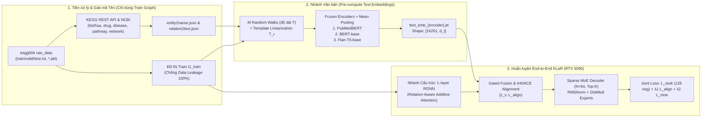

# Kế hoạch Triển khai Mô hình KLaR trên Tập dữ liệu `kegg50k`

## 1. Mục tiêu (Goal Description)
Xây dựng và chạy hoàn chỉnh pipeline **KLaR** bám sát 100% đặc tả kỹ thuật của bài báo (*Bioinformatics*, 2026 — [KLaR_Model_Spec.md](file:///d:/KLaR/KLaR_Model_Spec.md)) trên tập dữ liệu **`kegg50k`** (16.201 thực thể, 9 loại quan hệ, 57.080 train / 3.000 valid / 3.000 test triples), sử dụng 3 bộ mã hóa văn bản đóng băng (**PubMedBERT**, **BERT**, **Flan-T5**) và tối ưu hóa hiệu năng huấn luyện cho card **NVIDIA RTX 5090 (32GB VRAM)**.

---

## 2. Các Điểm Thiết kế Cốt lõi (Key Design Decisions)

> [!IMPORTANT]
> **Chống Rò rỉ Dữ liệu (Zero Data Leakage)**:
> Khác với script cũ trong repo (vốn gộp cả `train + val + test` vào `reverse_graph.json`), toàn bộ quá trình dựng đồ thị lân cận, trích xuất $k$-hop subgraph $G_v$, lấy mẫu đường đi ngẫu nhiên $\mathcal{P}_v$ và truyền thông điệp trên mạng **RGNN** chỉ sử dụng duy nhất các cạnh trong **`train.txt`** (57.080 cạnh). Các cạnh `valid.txt` và `test.txt` chỉ dùng để tính loss/ranking khi đánh giá.

> [!TIP]
> **Tận dụng sức mạnh GPU RTX 5090**:
> 1. **Pre-compute Text Embeddings ($t_v \in \mathbb{R}^{|\mathcal{V}| \times d_t}$)**: Toàn bộ quá trình chạy Frozen Encoder (PubMedBERT / BERT / Flan-T5) + Mean Pooling trên kho ngữ cảnh $C_v$ của 16.201 thực thể được tính 1 lần duy nhất và lưu ra file `.pt`. Khi train KLaR, mô hình chỉ cần đọc bảng $t_v$ từ VRAM, giúp tốc độ mỗi epoch trên RTX 5090 chỉ mất vài giây.
> 2. **Vectorized Relation-Aware RGNN**: Với đồ thị `kegg50k` (16.201 nodes, 57.080 train edges), toàn bộ phép truyền thông điệp RGNN với **Relation-Aware Additive Attention** (softmax chuẩn hóa riêng trong từng nhóm láng giềng cùng quan hệ $r \in \mathcal{R}$ bằng `scatter_reduce` / `scatter_add` thuần PyTorch) chạy trực tiếp bằng Sparse Edge Index trên GPU trong vài mili-giây.

---

## 3. Chi tiết Các File Đã Tạo Mới & Triển Khai

### Thành phần 1: Giải mã Tên Thực thể & Tiền xử lý `kegg50k`
- **File**: `data/kegg50k/kegg50k_data_processing.py`
- Tự động gọi KEGG REST API (`list/hsa`, `list/drug`, `list/disease`, `list/pathway/hsa`, `list/network`) giải mã **99.33%** (16.093 / 16.201) thực thể sang tên sinh học chuẩn (Gene Symbol + Full Name, Drug Name, Disease Name, Pathway Name, Network Name).
- Định nghĩa bảng mẫu câu quan hệ $T_r$ (cả chiều thuận và chiều nghịch) cho 9 quan hệ của `kegg50k`.
- Lấy mẫu $M=16$ random walks độ dài tối đa $T=6$ **chỉ trên đồ thị Train** và xuất ra `data/kegg50k/pro_data/entity_corpus.jsonl`.

### Thành phần 2: Tiền trích xuất Biểu diễn Văn bản (Frozen Text Encoder + Mean Pooling)
- **File**: `klar/data/precompute_text_emb.py`
- Hỗ trợ `--encoder {pubmedbert,bert,flant5,qwen3}` với Attention-Masked Mean Pooling chuẩn xác, đóng băng hoàn toàn trọng số (`requires_grad=False`, `torch.no_grad()`), lưu ra `data/kegg50k/pro_data/text_emb_{encoder}.pt`.

### Thành phần 3: Kiến trúc Mô hình KLaR Chuẩn Đặc tả
- **File**: `klar/model/klar_net.py`
- `RelationAwareRGNN`: Truyền thông điệp $L$ lớp với Relation-Aware Additive Attention, chuẩn hóa softmax riêng trong từng nhóm $\mathcal{N}_r(u)$ qua `segment_softmax`.
- `GatedStructureTextFusion`: Hai MLP $\phi_s, \phi_t$, cổng động $\gamma_v \in (0, 1)^d$ và hàm mất mát tương phản InfoNCE ($\mathcal{L}_{\text{align}}$).
- `DistMultSparseMoEDecoder`: Chuẩn hóa `RMSNorm`, Router $\text{MLP}_g([z_h; r_r])$, chọn Top-$K$ trong $N=64$ chuyên gia DistMult ($E_k(z_h, z_t, r_r) = \langle z_h, r_r^{(k)} \odot z_t \rangle$), kèm hàm điều chuẩn cân bằng tải $\mathcal{L}_{\text{moe}} = \lambda_{\text{load}}\mathcal{L}_{\text{load}} + \lambda_{\text{imp}}\mathcal{L}_{\text{imp}}$.
- `KLaRLightningModule`: Huấn luyện với 128 mẫu âm mỗi bộ ba dương (50% head / 50% tail), hàm loss tổng hợp $\mathcal{L} = \mathcal{L}_{\text{rank}} + \lambda_1\mathcal{L}_{\text{align}} + \lambda_2\mathcal{L}_{\text{moe}}$, và giao thức đánh giá **Filtered Link Prediction** (`MRR, Hits@1, Hits@3, Hits@10`).

### Thành phần 4: Script Huấn luyện Đa Seed & Bash Script cho Server RTX 5090
- **File**: `train_klar.py` & `scripts/run_kegg50k.sh`
- Tự động chạy huấn luyện và đánh giá trên 3 random seeds (`42 100 2026`) cho cả 3 mô hình `pubmedbert`, `bert`, `flant5` và lưu kết quả tổng hợp `Mean ± Std` vào `output/results_kegg50k_{encoder}.json`.
